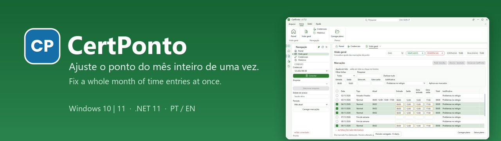
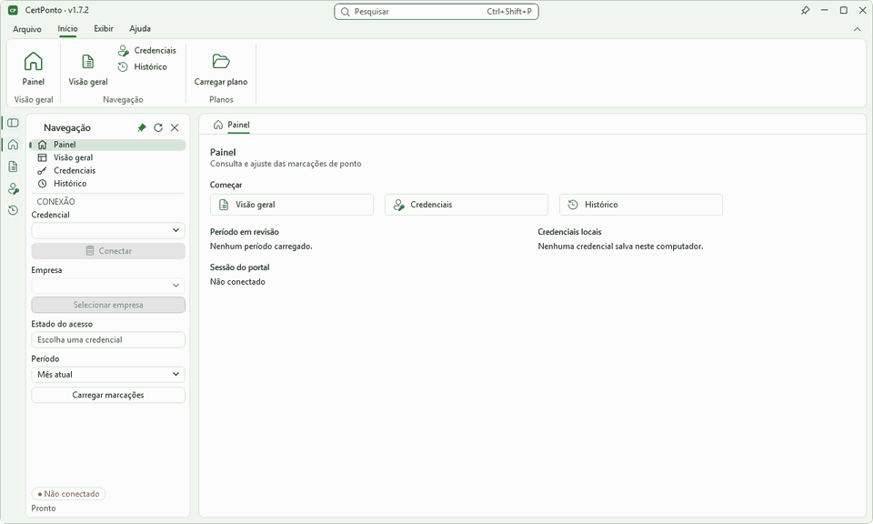
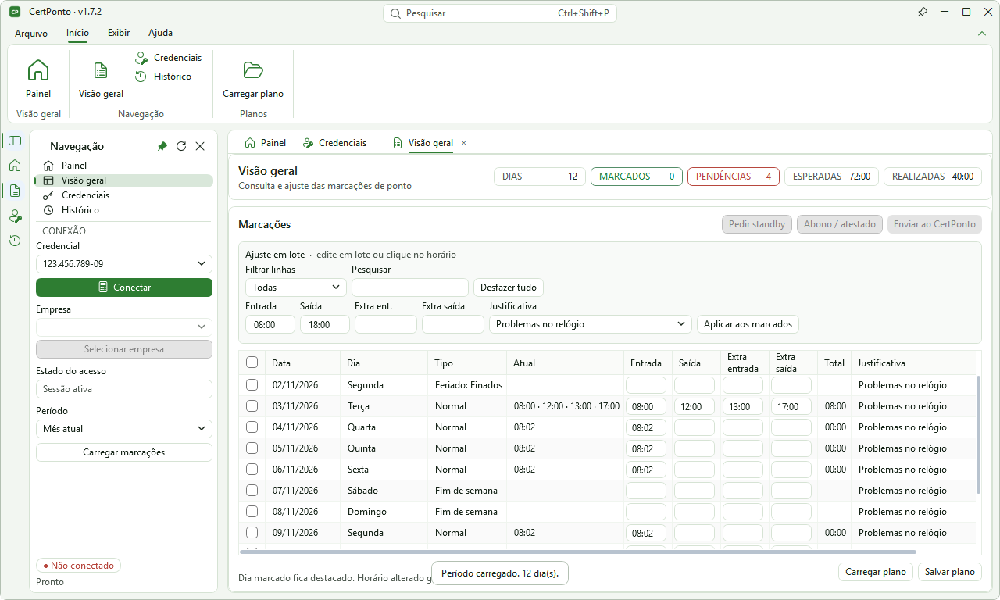
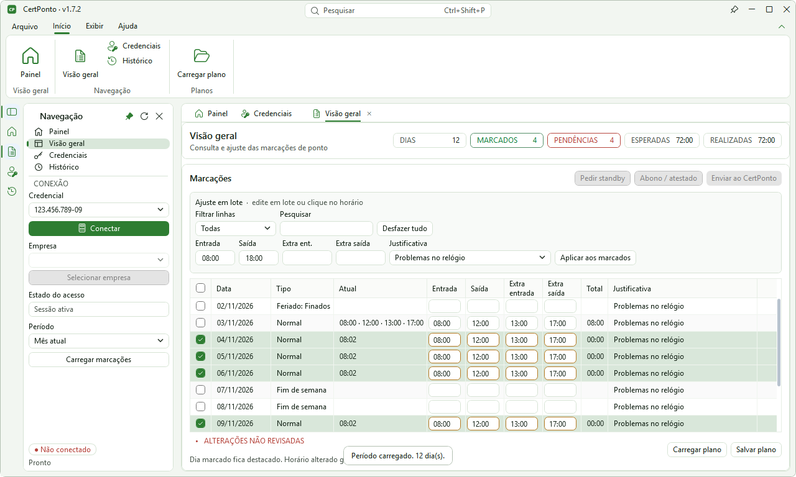
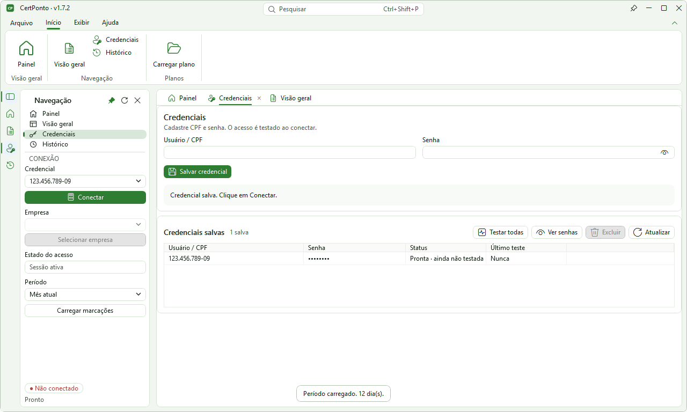
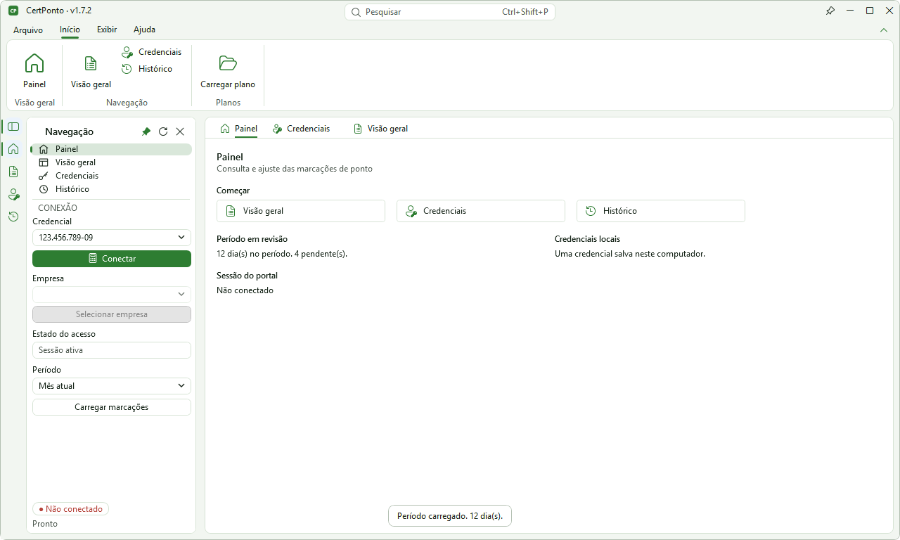
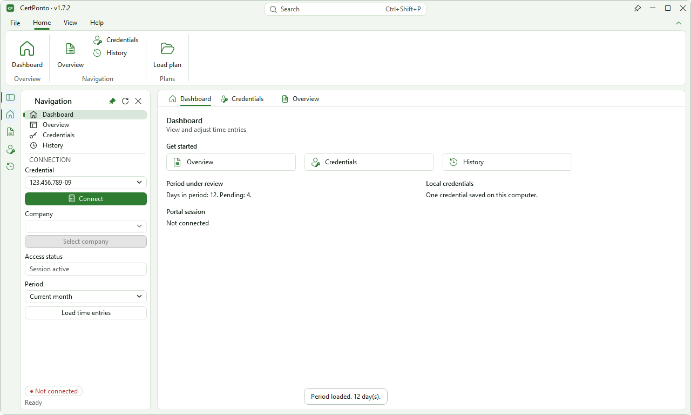
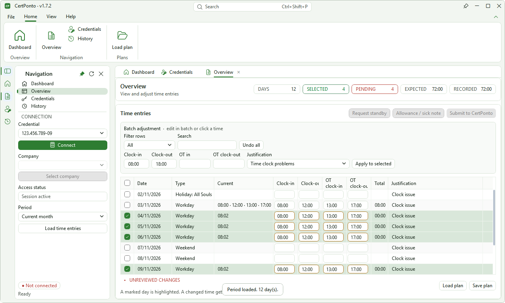
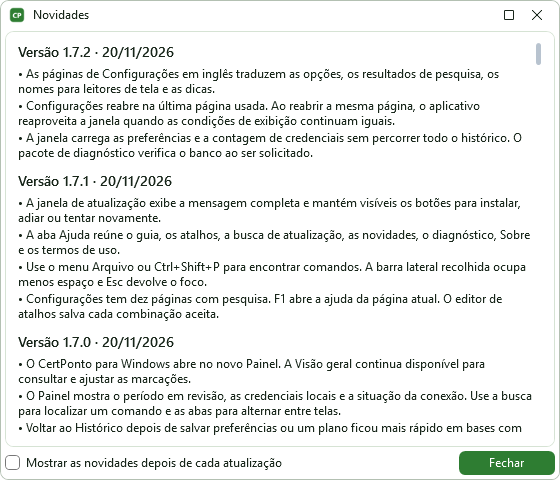
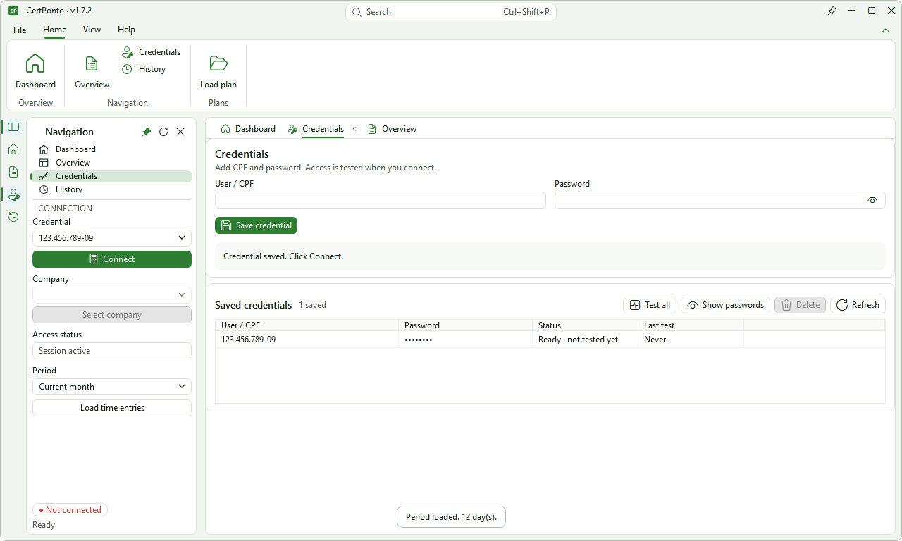

    

<b>Ajuste o ponto do mês inteiro de uma vez, sem editar dia por dia.</b> <i>Fix a whole month of time entries at once, without editing day by day.</i>

 Em uso: salvar a credencial, abrir o período, marcar os dias pendentes e preencher os horários. / <a href="telas/uso-en.gif">English version of the animation</a>.

## O que é / What it is
O CertPonto é para quem precisa revisar e corrigir as marcações de ponto no portal da empresa. Ele traz o período inteiro para uma grade, mostra o que falta, deixa ajustar vários dias de uma vez e envia tudo ao portal depois da sua conferência. Também pede standby, abona dias e guarda o histórico do que foi enviado.
*CertPonto is for people who need to review and fix their time-clock entries on the company portal. It brings the whole period into one grid, shows what is missing, lets you adjust many days at once and sends everything to the portal after you check it. It also requests standby, justifies absences and keeps a history of what was sent.*

## Destaques / Highlights
| | |
|---|---|
| **O mês inteiro numa grade** — dias, horários atuais, pendências e horas esperadas e realizadas, num só lugar. *The whole month in one grid — days, current times, pending items and expected vs. recorded hours in one place.* |  |
| **Ajuste em lote** — marque os dias e preencha entrada e saída de uma vez; cada horário alterado fica destacado até o envio. *Batch adjustment — select the days and fill in clock-in and clock-out at once; every changed time stays highlighted until you send it.* |  |
| **Senhas guardadas só neste computador** — cadastre o CPF uma vez, a senha fica protegida e o acesso é testado ao conectar. *Passwords kept only on this computer — register your ID once; the password is protected and access is tested when you connect.* |  |

## Como funciona / How it works
1. Instale ou abra o portátil e cadastre seu CPF e senha em **Credenciais**. / *Install or open the portable version and add your ID and password under **Credentials**.*
2. Clique em **Conectar**, escolha a empresa e o período e clique em **Carregar marcações**. / *Click **Connect**, choose the company and period and click **Load time entries**.*
3. Marque os dias, ajuste os horários, confira a prévia e clique em **Enviar ao CertPonto**. / *Select the days, adjust the times, check the preview and click **Submit**.*

## Funcionalidades / Features
| Recurso / Feature | O que faz / What it does |
|---|---|
| Painel / Dashboard | Período em revisão, credenciais e situação da conexão. / *Period under review, credentials and connection status.* |
| Visão geral / Overview | Grade do período com filtros, busca e totais de horas. / *Period grid with filters, search and hour totals.* |
| Ajuste em lote / Batch adjustment | Mesmos horários e justificativa para vários dias. / *Same times and justification for many days.* |
| Prévia e envio / Preview and submit | Mostra o que vai mudar antes de enviar; dias com falha são repetidos. / *Shows what will change before sending; failed days are retried.* |
| Standby e abono / Standby and absences | Pede standby e abona dias (atestado) a partir da grade. / *Requests standby and justifies absences from the grid.* |
| Histórico / History | Tudo o que foi enviado, por CPF e mês, com exportação CSV/PDF. / *Everything sent, by ID and month, with CSV/PDF export.* |
| Planos e rascunhos / Plans and drafts | Salva o ajuste para terminar depois; o que não foi enviado não se perde. / *Saves your work to finish later; nothing unsent is lost.* |
| Backup, temas e idiomas / Backup, themes, languages | Backup dos dados, tema claro/escuro, cores, escala e PT/EN. / *Data backup, light/dark theme, colors, scale and PT/EN.* |

## Galeria / Gallery
| | |
|---|---|
|  Painel com o período carregado |  *Dashboard with the period loaded* |
|  Visão geral: dias pendentes em vermelho |  *Overview: batch adjustment in English* |
|  Configurações com busca |  *Searchable settings* |
|  Novidades de cada versão |  *Saved credentials* |

## Baixar / Download
- [Versão mais nova: instalador (.msi) e portátil (.zip), sem runtime embutido / Latest version: installer (.msi) and portable (.zip), no bundled runtime](https://github.com/Dorflex-DD/CertPonto/releases/latest)

Windows 10/11 x64 · .NET 11 Desktop Runtime

## Novidades / What's new — v1.7.2
- Configurações em inglês com opções, busca e dicas traduzidas. / *Settings fully in English: options, search and tooltips.*
- Configurações reabre na última página usada, mais rápido. / *Settings reopens on the last page used, faster.*
- Preferências e credenciais carregam sem percorrer todo o histórico. / *Preferences and credentials load without scanning the whole history.*

Uso gratuito, somente com autorização escrita do autor ([Termos de Uso](https://github.com/Dorflex-DD/CertPonto/releases/latest/download/LICENSE)). Imagens com dados fictícios. / Free use only with the author's written authorization. Images use fictitious data.
