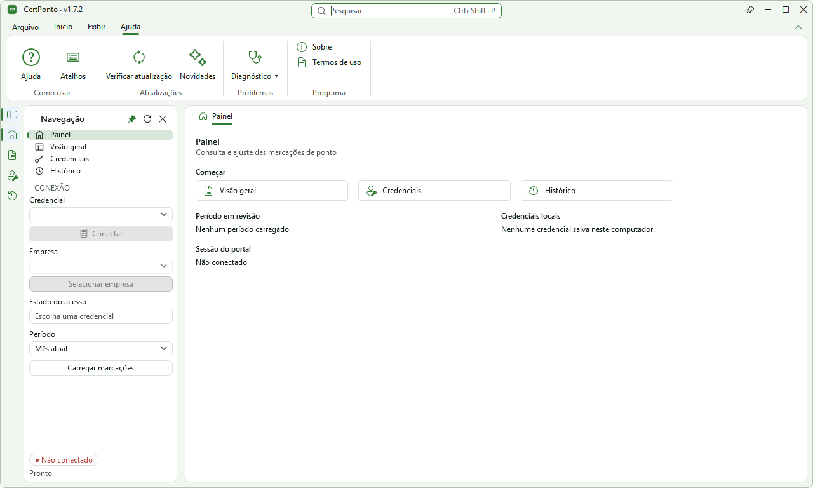
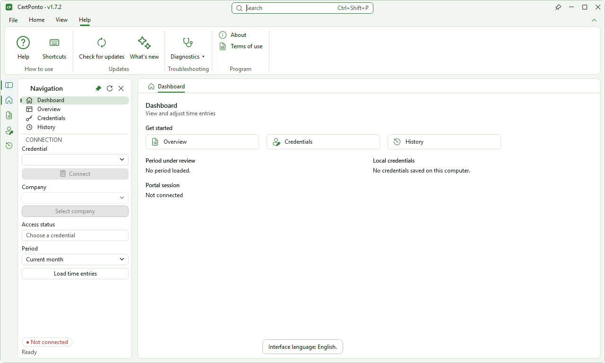
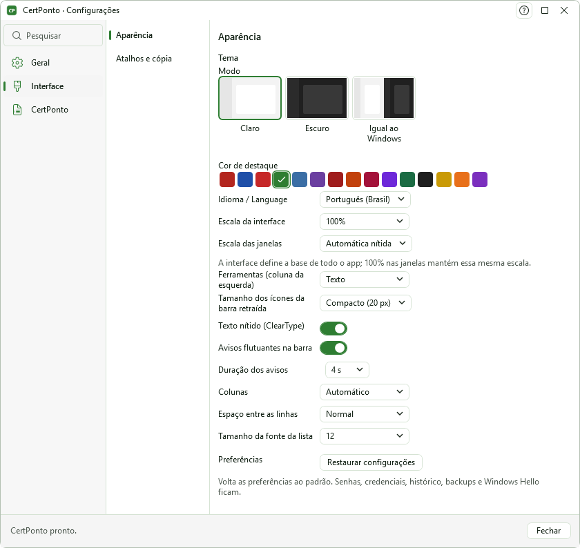
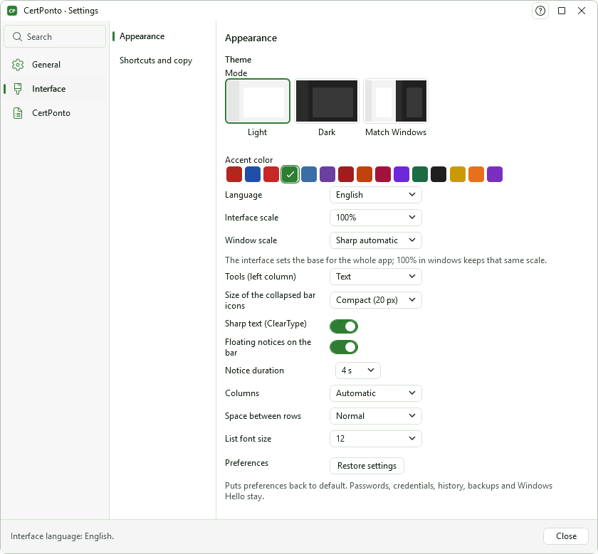
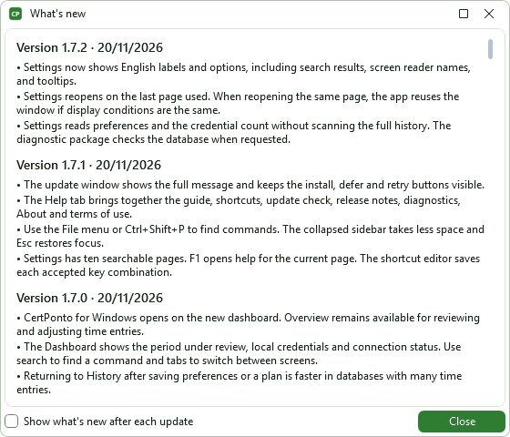

# CertPonto

**PT** — Revisa e ajusta as marcações de ponto no portal sem editar dia por dia; também pede standby, abona dias e guarda o histórico. App para Windows.

**EN** — Reviews and adjusts time-clock entries on the portal without editing day by day; also requests standby, justifies absences and keeps a history. Windows app.

**[Baixar a última versão / Download the latest version](https://github.com/Dorflex-DD/CertPonto/releases/latest)**

## Telas / Screenshots

| Português | English |
|---|---|
|  |  |
| Painel: período em revisão, credenciais locais e situação da conexão. | Dashboard: period under review, local credentials and connection status. |
|  |  |
| Configurações com busca: tema claro/escuro, cor, idioma e escala. | Searchable settings: light/dark theme, accent color, language and scale. |
|  |  |
| Novidades de cada versão. | Release notes for each version. |

Imagens da versão publicada, com dados fictícios. / Images of the published version, with fictitious data.

## O que precisa estar instalado / Requirements

- Windows 10 ou 11, 64 bits / Windows 10 or 11, 64-bit
- [.NET 11 Desktop Runtime x64](https://dotnet.microsoft.com/download/dotnet/11.0)

## Duas formas / Two ways

- **Instalador / Installer (.msi, .exe):** instala para o seu usuário, com atalhos; a atualização mantém tudo. / Installs for your user with shortcuts; updates keep your data.
- **Portátil / Portable (.zip):** descompacte e use; tudo fica na pasta do app. / Unzip and run; everything stays in the app folder.

Desinstalar apaga tudo do CertPonto neste computador, inclusive credenciais, senhas, histórico e logs. Se quiser guardar, exporte um backup antes.

## Licença / License

**Uso gratuito, somente com autorização por escrito do autor.**
Peça a autorização somente por e-mail a fabio.s91@icloud.com, com o nome do app (CertPonto) no assunto.
Não pode modificar, copiar para outras pessoas nem vender. Empresas precisam de autorização própria.
Uso sem autorização sujeita a multa e indenização.
Termos de Uso completos em [LICENSE](https://github.com/Dorflex-DD/CertPonto/releases/latest/download/LICENSE). As licenças das bibliotecas de terceiros vão dentro do zip.

## Autor / Author

**Fabio Fernando Giacomelli** © 2024-2026 — [LinkedIn](https://www.linkedin.com/in/fabio-g-23a590168/)
